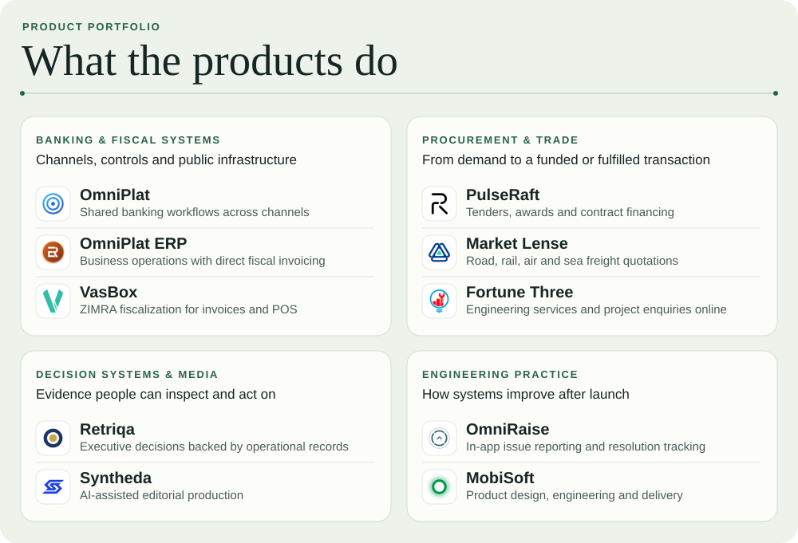
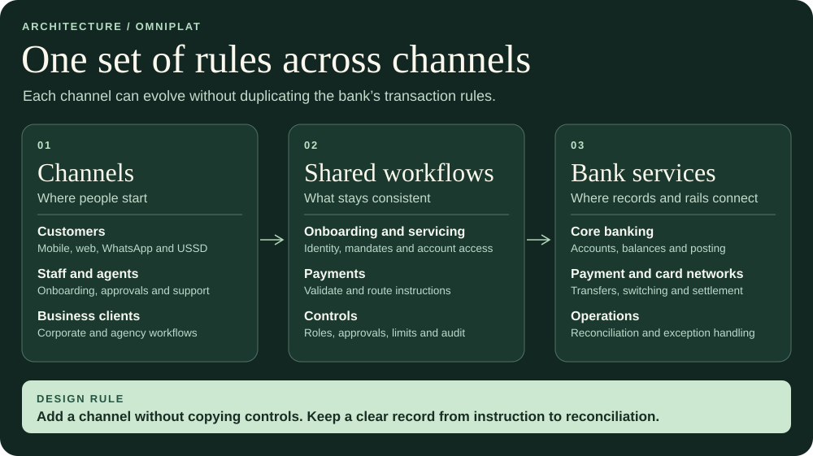

# Gedion Moyo

**Founder & CEO of MobiSoft and Retriqa · Software architect · Harare, Zimbabwe**

Gedion Moyo leads product strategy and software architecture for digital banking, fiscalization, procurement and executive decision systems. His work focuses on what platforms should share, which decisions institutions need to control, and how teams keep services running after launch.

[MobiSoft](https://mobisoft.co.zw) · [OmniPlat](https://omniplat.ai) · [Retriqa](https://retriqa.ai) · [LinkedIn](https://www.linkedin.com/in/gedionmoyo/)

## Portfolio map

## Selected work

**Banking and fiscal systems.** [OmniPlat](https://omniplat.ai) gives financial institutions shared onboarding, payment and servicing workflows across mobile, web, WhatsApp, USSD and agency channels. **MyZB** gives ZB Financial Holdings customers online banking access; **A360** serves BancABC Zimbabwe customers through its mobile app and USSD. [VasBox](https://vasbox.co.zw) connects invoicing and point-of-sale systems to ZIMRA. [OmniPlat ERP](https://www.erp.co.zw) lets businesses issue fiscal invoices and receipts directly through ZIMRA while recording sales in the same workflow.

**Procurement and trade.** [PulseRaft](https://pulseraft.com) gives buyers one record for approvals, bids and awards, and suppliers one profile they can reuse across tenders. Investors can evaluate awarded contracts and verified invoices for financing. [Market Lense](https://marketlense.co.zw) lets importers estimate road, rail, air and sea freight before requesting a firm quote. The [Fortune Three Engineers website](https://fortunethree.com) presents the firm's engineering services and projects and gives prospective clients a direct route to make an enquiry.

**Decision systems and media.** [Retriqa](https://retriqa.ai) gives leadership a way to follow finance, operations and governance and trace reported figures back to the records behind them. [Syntheda](https://syntheda.ai) applies AI agents to the editorial workflow for coverage of Zimbabwean business, technology and public affairs.

**Engineering practice.** **OmniRaise** connects in-app issue reporting with the engineering team's case history, so people can follow a problem from report to resolution without leaving the product.

**Earlier consumer finance.** [MobiLedger](https://www.techzim.co.zw/2015/02/zim-developer-comes-ecocash-ledger-app-monitor-m-money-transactions/) helped EcoCash users track and categorise transactions in 2015. [CashLedger](https://www.techzim.co.zw/2019/07/local-finance-app-cashledger-now-available-globally/) took that approach beyond Zimbabwe in 2019, turning transaction messages into a usable spending record.

## Platform architecture

Customer channels can evolve independently when the underlying transaction rules stay consistent. OmniPlat separates channel experience from shared workflows, while the bank retains control over approvals, limits and its systems of record. The operating test is whether teams can trace an instruction through posting and reconciliation, and resolve an exception without guessing where it happened.
