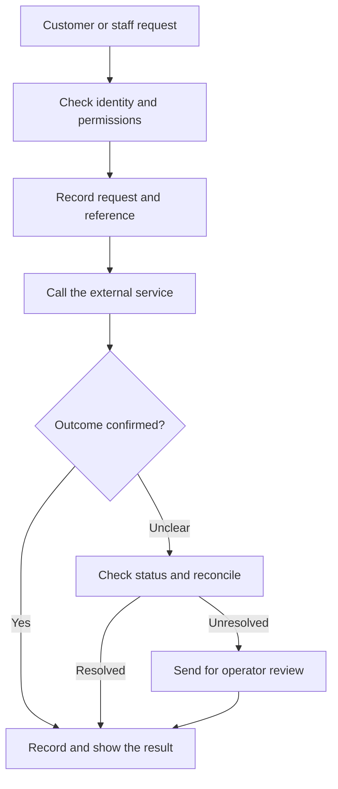
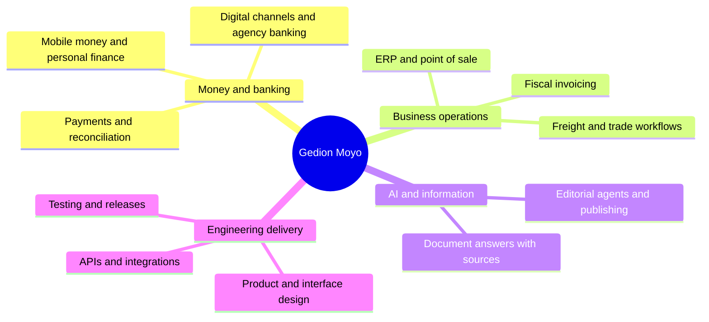

# Gedion Moyo

**Software founder and hands-on builder · Harare, Zimbabwe**

I founded [MobiSoft](https://mobisoft.co.zw) and [Retriqa](https://retriqa.ai). I lead teams and stay close to the work: designing products, building integrations, reviewing code and getting releases out. A lot of my work is in financial services, but the problems I like show up everywhere: moving money, making sense of documents, getting goods across borders, and giving people simpler ways to do work they already understand.

[MobiSoft](https://mobisoft.co.zw) · [LinkedIn](https://www.linkedin.com/in/gedionmoyo/)

## Selected work

| Area | What I’ve worked on |
| --- | --- |
| **Banking and payments** | With the MobiSoft team, I helped design and deliver MyZB for ZB Financial Holdings and A360 mobile and USSD banking for BancABC Zimbabwe. That work continues in [OmniPlat](https://omniplat.ai), which brings web, mobile, USSD, WhatsApp and agency banking together with the tools bank staff use to run them. |
| **Business software and tax** | [VasBox](https://vasbox.co.zw) connects invoices and receipts to ZIMRA. I’m also working on [ERPNext for Zimbabwean businesses](https://www.erp.co.zw), where fiscal invoices and POS receipts go directly to ZIMRA from the sales workflow. |
| **AI and publishing** | [Retriqa](https://retriqa.ai) helps teams ask questions about their documents and trace answers back to the source. I built **Syntheda** to explore how AI could support a publication covering African business, markets and technology. [The Syntheda story](https://www.techzim.co.zw/2026/02/zim-fintech-veteran-builds-an-entire-news-platform-using-ai-no-human-written-code/) |
| **Trade and logistics** | For [Market Lense](https://marketlense.co.zw), I’ve worked on making freight quotes and requests easier to handle across road, rail, air and sea. Customers can get an estimate before supplying everything needed for a firm quote. |
| **Consumer finance** | In 2015 I built [MobiLedger](https://www.techzim.co.zw/2015/02/zim-developer-comes-ecocash-ledger-app-monitor-m-money-transactions/) to help people track EcoCash transactions. In 2019, the MobiSoft team took [CashLedger](https://www.techzim.co.zw/2019/07/local-finance-app-cashledger-now-available-globally/) beyond Zimbabwe. |

## The work behind the screens

Two questions I ask when building a system: What will the person using it have to do twice? And what will the person operating it see when something goes wrong? Those questions apply whether it’s a transfer that times out, a tax receipt that needs correcting, or an AI answer that someone has to verify.

### How I design a transaction workflow

This is a design pattern I use for systems that depend on another service. It shows what should happen when the outcome is unclear.

### Map of my work

I work across product design, application architecture, APIs, testing and deployment. I spend much of my time with PHP and Laravel, TypeScript, Python and GitHub Actions. Most of my GitHub work is in private repositories, so the public links above are the best way to see what I work on.
