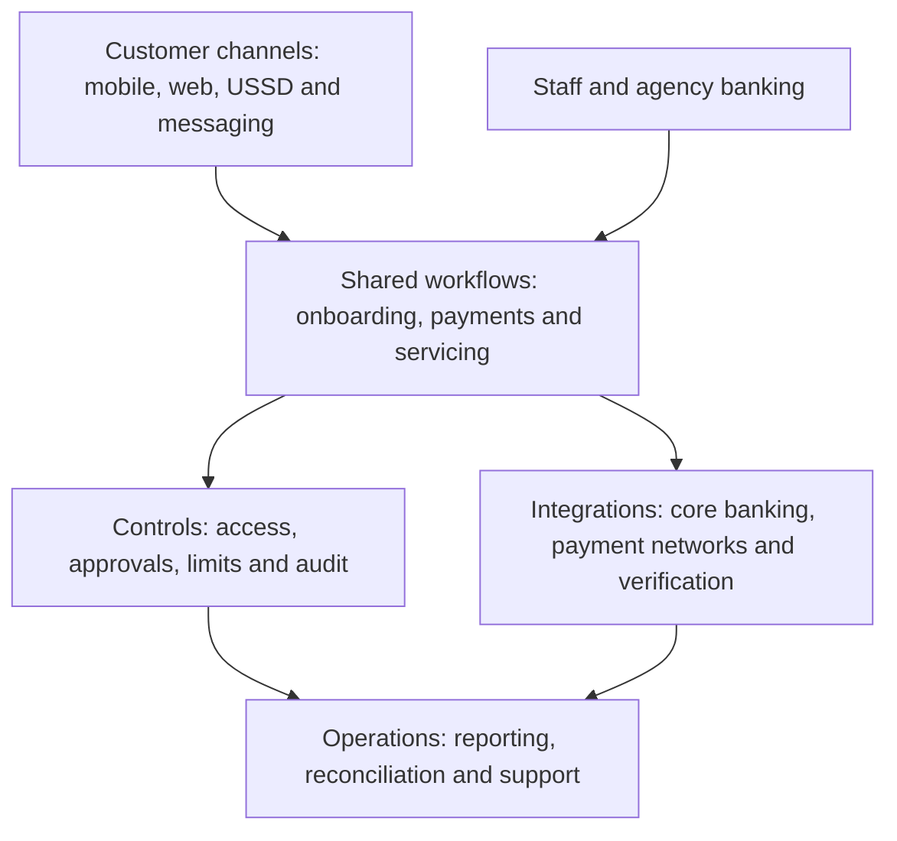
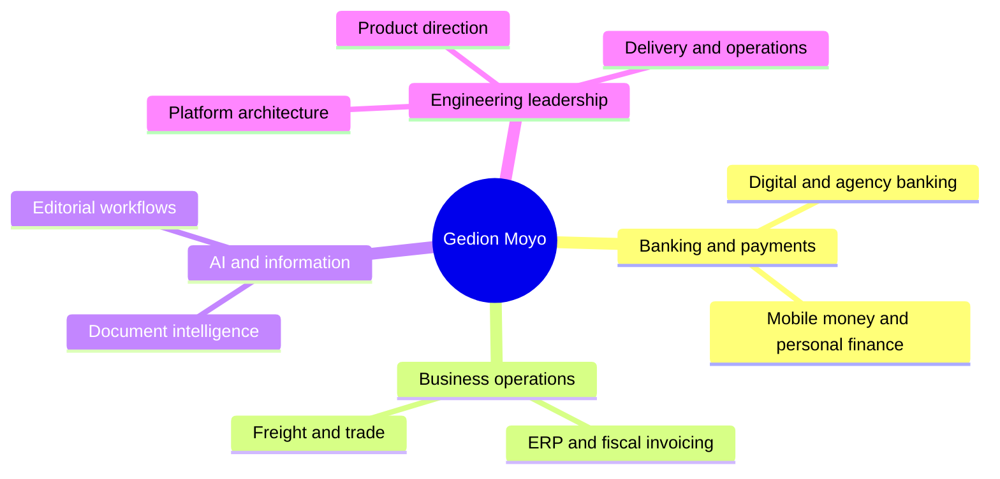

# Gedion Moyo

**Founder & CEO, MobiSoft and Retriqa · Harare, Zimbabwe**

I lead software businesses and set the architectural direction for the products we build. My work spans banking and payments, business software, AI and trade. In each, my role is to decide what is worth building, what should be shared across products, and what needs to stay specific to the institution or market.

[MobiSoft](https://mobisoft.co.zw) · [Retriqa](https://retriqa.ai) · [LinkedIn](https://www.linkedin.com/in/gedionmoyo/)

## Selected work

| Area | Work |
| --- | --- |
| **Banking and payments** | My team at MobiSoft designed and delivered MyZB for ZB Financial Holdings and A360 mobile and USSD banking for BancABC Zimbabwe. With [OmniPlat](https://omniplat.ai), we’re building a common foundation for banking across mobile, web, USSD, WhatsApp and agent networks. |
| **Business operations** | [VasBox](https://vasbox.co.zw) connects invoicing and receipts to ZIMRA. Our [ERPNext work](https://www.erp.co.zw) brings that capability directly into the sales workflow, without requiring a separate fiscal invoicing system. |
| **AI and information** | I founded [Retriqa](https://retriqa.ai) to help teams work with their own documents and verify the sources behind an answer. With [Syntheda](https://www.techzim.co.zw/2026/02/zim-fintech-veteran-builds-an-entire-news-platform-using-ai-no-human-written-code/), I explored how AI agents could run an editorial workflow for a publication covering African markets, business and technology. |
| **Trade and logistics** | For [Market Lense](https://marketlense.co.zw), I’ve worked on making it easier to get a freight estimate and turn it into a firm quote across road, rail, air and sea. |
| **Consumer finance** | In 2015 I built [MobiLedger](https://www.techzim.co.zw/2015/02/zim-developer-comes-ecocash-ledger-app-monitor-m-money-transactions/) to help people track EcoCash transactions. In 2019, the MobiSoft team took [CashLedger](https://www.techzim.co.zw/2019/07/local-finance-app-cashledger-now-available-globally/) beyond Zimbabwe. |

## How I think about platform architecture

A bank should be able to add a channel without rebuilding the workflows behind it. The channels can feel different while payment rules, approvals and records stay consistent. The diagram shows the boundaries I look for when designing that kind of platform.

## Map of my work

## What I look for in a design

Can the next product reuse it? Can the institution operate it without the people who built it? Can a team change one part without putting the rest at risk? Those questions guide what I standardise, where I leave teams room to choose, and what I’m willing to put into production.

Most of my GitHub work is in private repositories. The links above show the public side of that work.
