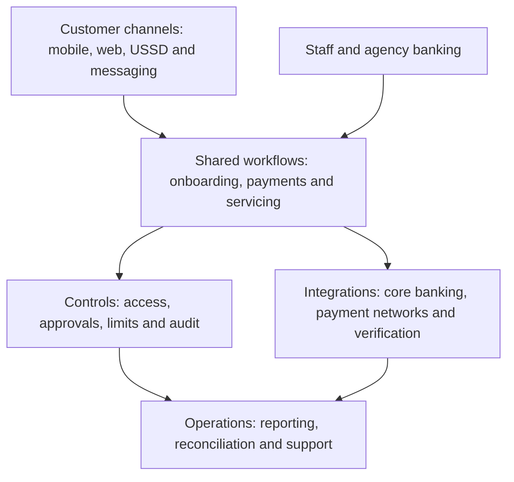
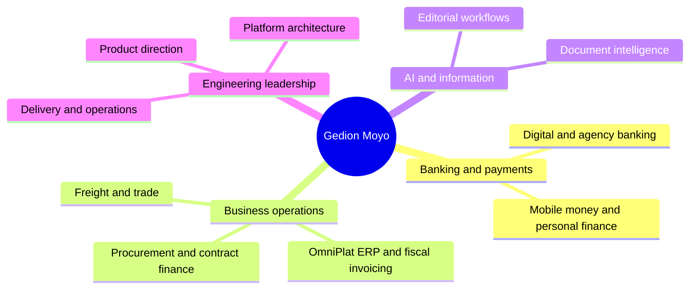

# Gedion Moyo

**Founder & CEO, MobiSoft and Retriqa · Harare, Zimbabwe**

Gedion Moyo leads product strategy and software architecture across banking, payments, business operations, AI and trade. His focus is on where a shared platform makes sense, what each institution needs to control, and what teams can operate and change after launch.

[MobiSoft](https://mobisoft.co.zw) · [OmniPlat](https://omniplat.ai) · [Retriqa](https://retriqa.ai) · [LinkedIn](https://www.linkedin.com/in/gedionmoyo/)

## Selected work

| Area | Products and what they make possible |
| --- | --- |
| **Banking and payments** | **MyZB** gives ZB Financial Holdings customers a digital banking channel. **A360** provides BancABC Zimbabwe customers with mobile app and USSD access. [OmniPlat](https://omniplat.ai) takes the platform approach further: banks can add customer and agent channels without rebuilding the onboarding, payment and servicing workflows behind them. |
| **Business operations and tax** | [VasBox](https://vasbox.co.zw) connects invoicing and point-of-sale systems to ZIMRA. [OmniPlat ERP](https://www.erp.co.zw) connects directly to ZIMRA, so sales teams can issue fiscal invoices and receipts in the same workflow they use to record the sale. |
| **Procurement and contract finance** | [PulseRaft](https://pulseraft.com) gives buyers one record for approvals, bids and awards, and suppliers one profile they can reuse across tenders. Investors can review awarded contracts and verified invoices for financing. |
| **AI and information** | [Retriqa](https://retriqa.ai) lets teams ask questions of their own documents and check the sources before acting on an answer. [Syntheda](https://www.techzim.co.zw/2026/02/zim-fintech-veteran-builds-an-entire-news-platform-using-ai-no-human-written-code/) explores how AI agents can run an editorial workflow for a publication on African markets, business and technology. |
| **Trade and logistics** | [Market Lense](https://marketlense.co.zw) gives importers a way to estimate freight across road, rail, air and sea, then provide the shipment details needed for a firm quote. That separates early budgeting from the work of arranging a shipment. |
| **Consumer finance** | [MobiLedger](https://www.techzim.co.zw/2015/02/zim-developer-comes-ecocash-ledger-app-monitor-m-money-transactions/) helped EcoCash users track and categorise transactions in 2015. [CashLedger](https://www.techzim.co.zw/2019/07/local-finance-app-cashledger-now-available-globally/) took the idea beyond Zimbabwe in 2019, turning transaction messages into a usable spending record. |

## Platform architecture

A bank should be able to add a channel without rebuilding the workflows behind it. Customer and staff experiences can differ while payment rules, approvals and records stay consistent across channels.

## Portfolio map

## Architecture decisions

Shared workflows are worth standardising when they let teams add products or channels without duplicating the rules. Institutions still need control over their own policy and approvals. A design is ready for production when the people running it can see what happened, resolve exceptions and change one part without putting the rest at risk.
